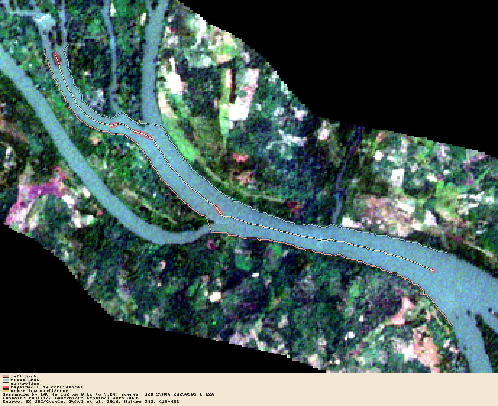

# Worked example: the Sassandra

> **Screening — not for construction.** The depth here is assumed, not measured, and several defaults are
> provisional (listed below). Read the limits before you use a number.

What barge could use the Sassandra, Côte d'Ivoire, from the sea at Sassandra town up to the Soubré dam, and
what would the next size up need? This page is the answer OWD gives with nothing but open data: a river name,
two points, and one depth from people who know the river.

## Run it

```bash
bash examples/sassandra/run.sh
```

It needs the network and takes about 20 minutes, most of it the route (Overpass) and the edge fit. Everything
is fetched at run time into `sassandra-study/`; nothing is bundled. The script:

1. `owd reach` plans the route on the OpenStreetMap waterways (144 km, six ways). It makes the bank lines from
   the JRC water mask, then moves them onto dry-season Sentinel-2 scenes, tile by tile.
2. `owd fetch-dem` gets the Copernicus GLO-30 DEM. `owd water-level` sets the low-water level from SWORD and
   SWOT, with the DEM where they give none.
3. `owd fits` gives the plan-only answer: width and radius, no depth.
4. `owd bed --depth 3 --season dry` gives the one depth people who use the river know: 3 m at low water in the
   dry season.
5. `owd fits` again gives the full answer: width, radius and depth, with a verdict for each vessel class.
6. The same full answer, reading the river's radius on each class's fairway fit (`--plan-line fairway`).

## Check the banks by eye

Spec 0013 seeds the bank lines from the water seen in Sentinel-2 itself, checks and repairs them, and
draws them over the image so you can check a stretch:

```bash
owd qa-overlay sassandra.owd --png km148-152.png --kmz km148-152.kmz --from-km 148 --to-km 152
```

This is km 148 to 152, where the river opens into the Soubré reservoir, on the recorded window of the
acceptance test (`crates/owd-reach/tests/s2window.rs`): the left bank in red, the right in blue, the
centreline in cream, and the repaired stretches to check in red bands.



On this window the median width is 199 m from the seed and 202 m after the edge fit, against 219 m of
open water measured on the scene across nine transects. The JRC mask alone gives 112 m. No station has
both banks on one side, and the centreline is within 1 m of the banks' mid-line at the 95th percentile.

> The whole-river numbers below are from the spec 0012 run, with banks from the JRC mask. They are
> regenerated on the spec 0013 seed in a follow-up.

## The answer

Under PIANC WG 141 quality B, **no vessel class fits the Sassandra as it is.** Every class is
`navigable-with-works`: it can use the river after works. The table gives each class's constraint stretches
(where the river falls short) by kind.

| Class | Needs depth (m) | Plan only: fits? | Full, centreline: verdict, stretches (width / depth / radius) | Full, fairway: verdict, stretches (width / depth / radius) |
|---|---|---|---|---|
| CEMT_IV | 3.25 | no | navigable-with-works: 228 / 1 / 1009 | navigable-with-works: 228 / 1 / 148 |
| CN_IV_motor | 2.08 | no | navigable-with-works: 194 / 4 / 894 | navigable-with-works: 194 / 4 / 163 |
| CN_III_motor | 2.6 | no | navigable-with-works: 230 / 10 / 1009 | navigable-with-works: 230 / 10 / 146 |
| CEMT_Va | 4.55 | no | navigable-with-works: 307 / 1 / 1080 | navigable-with-works: 307 / 1 / 119 |
| CEMT_Vb | 4.55 | no | navigable-with-works: 555 / 1 / 1060 | navigable-with-works: 555 / 1 / 151 |
| CN_II_motor | 3.38 | no | navigable-with-works: 277 / 1 / 1031 | navigable-with-works: 277 / 1 / 150 |
| CN_I_motor | 4.16 | no | navigable-with-works: 286 / 1 / 1048 | navigable-with-works: 286 / 1 / 150 |
| CEMT_VIa_motor_NL2011 | 5.2 | no | navigable-with-works: 406 / 1 / 1119 | navigable-with-works: 406 / 1 / 158 |
| CN_III_convoy_2ab | 2.6 | no | navigable-with-works: 523 / 10 / 1093 | navigable-with-works: 523 / 10 / 148 |
| CEMT_VIa | 4.55 | no | navigable-with-works: 341 / 1 / 1080 | navigable-with-works: 341 / 1 / 151 |
| CN_II_convoy_2ab | 3.38 | no | navigable-with-works: 575 / 1 / 1061 | navigable-with-works: 575 / 1 / 186 |
| CN_I_convoy_2ab | 4.55 | no | navigable-with-works: 649 / 1 / 1000 | navigable-with-works: 649 / 1 / 197 |

"Needs depth" is the class's design depth under the rule set. Where it is over the assumed 3 m, the whole river
is one depth stretch (works: dredge). Where it is 3 m or less, the few depth stretches left are single
stations (see "Limits").

### Two plan lines

The radius columns differ by plan line:
- **On the river centreline (the default):** about 1,000 radius stretches per class.
- **On each class's fairway fit:** about 150.

The centreline is drawn from the bank lines, and it wiggles at the scale of its 5 m stations. Each wiggle
reads as a tight bend, so most of those 1,000 are not the river. The fairway fit (ADR 0007) is the smoothest
line a channel of that class can take in the water. The radius stretches left on it are mostly where the
water itself forces a bend, but some may be where the fit is infeasible. **Which plan line is the default is
still to be decided.** Read the radius columns with this in mind.

## Labels and notices

Every output carries the screening label, and every answer carries "depth assumed, not measured". The study
carries these notices, and every export carries them too:

- © OpenStreetMap contributors (the route);
- Source: EC JRC/Google, Pekel et al. 2016 (the water mask);
- Contains modified Copernicus Sentinel data 2024 and 2025 (the bank lines: scenes S2A_29NRF_20241222,
  S2B_29NQF_20250205 and S2B_29NQG_20250126);
- SWOT data from NASA and CNES, served by PO.DAAC Hydrocron, and SWORD v17c, CC BY 4.0 (the water level,
  from 10 SWORD reaches, observations from July 2023 to October 2026);
- Produced using Copernicus WorldDEM-30 (the DEM).

## Provisional defaults

These are not yet calibrated against a surveyed reach. Each is named so in the study file.

| Default | Value | Used here |
|---|---|---|
| Water mask threshold (JRC occurrence) | 75 % | **30 %**: at 75 % the mask sees almost no water on this cloudy reach |
| Low-confidence width | under 3 mask pixels (90 m); under 30 m after the edge fit | as default |
| Edge fit | ±40 m search, at most 30 m shift, at most 1.5 m change per 5 m | as default, in parts of 15 km |
| Water level | SWOT 10th percentile per SWORD reach; the DEM under 100 m wide or with no SWOT | as default |
| Depth | none: the user gives one | 3 m, dry season |
| Bed shape | a parabola across the water | as default |

## Limits

- **The water mask.** The JRC mask needs a 30 % threshold here. This reach is cloudy so often that water
  rarely reaches 75 % occurrence. Even at 30 %, 322 stretches are narrower than three 30 m mask pixels.
- **The edge fit.**
  - 416 stretches are `at-shift-limit`: the water runs on past the 30 m limit, so the bank moved 30 m and the
    edge lies farther.
  - 157 are `no-edge`: no clear edge, so the mask bank is kept.
  - The bank lines are closer to the water than the mask's, not surveyed.
- **The depth is one assumed number.** Most classes need more than 3 m, so the whole river is one depth
  stretch for them. At a few stations the edge-fitted centreline leaves the water the bed model covers. There
  the DEM surface (which sits above the water) is read instead, and the depth found there is negative.
  These show as single-station depth stretches.
- **The plan line for the radius** is still to be chosen (above).
- **Width:** the width stretches use the banks as found, with the limits above.
- **Air draught, rapids and rock** are out of scope (#12, #13). The Soubré dam is the end of the reach.

## In the app

1. Press **Start from a river**.
2. Type *Sassandra*, then pick the start at the mouth and the end below the dam on the map (or type
   `-6.0780, 4.9605` and `-6.6550, 5.8020`). Press **Find the route**.
3. On the desktop app the JRC tiles are read for you. On the web, download the tile listed (`occurrence_10W_10N…`)
   and give it back. Keep **Move the banks onto Sentinel-2 imagery** ticked, then press **Make the inputs**.
4. Fetch or load the DEM (the tiles are listed). The water level comes from SWORD and SWOT.
5. Give a depth of 3 m, season *dry*, and press **Set the depth**.
6. Press **Answer what fits**. Pick a row to see its stretches on the map, and **Use this vessel** to go on to
   the alignment and the volumes.

The app's mask threshold is the default (75 %). For this river, use the CLI script above, or lower the
threshold once the app offers it.
